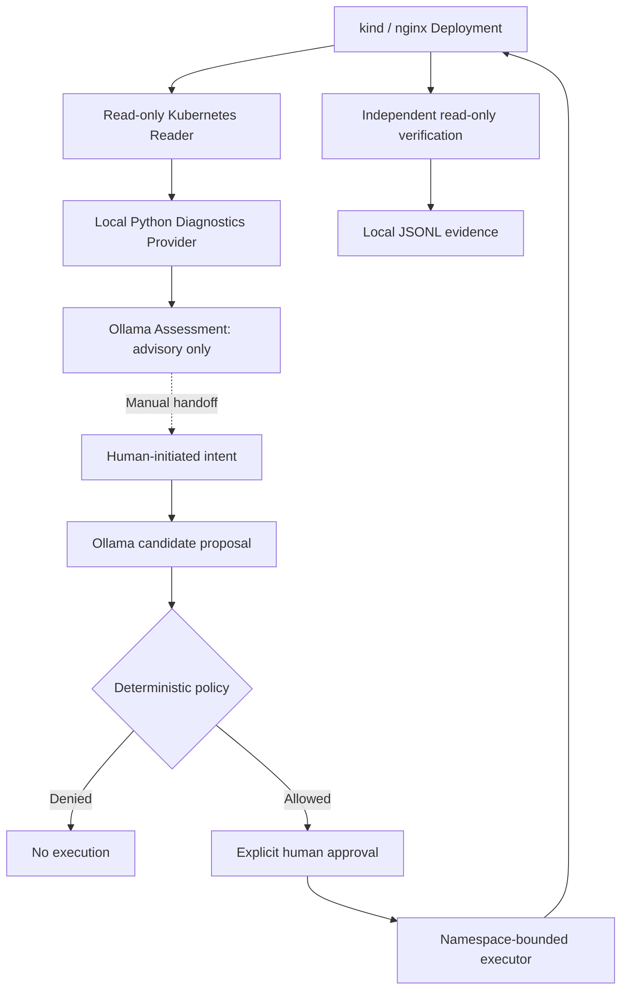
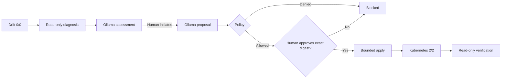
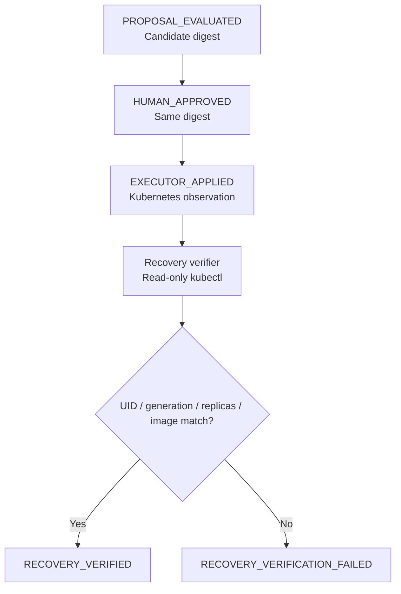

# AI Thinks. OpenKubes Executes. Evidence Proves.

*Build a human-governed AI recovery workflow for Kubernetes using OpenKubes, Ollama, and kind.*

**Hands-on tutorial · W-JAX 2026 · macOS · allow 45–60 minutes plus downloads**

This guide starts from a fresh clone of the maintained `main` branch. You explicitly create the cluster, namespace and workload, provision two separate identities, start Ollama, approve the repair and verify Kubernetes observations. There is no bootstrap command. The frozen `wjax-2026-demo-v1.0` tag is historical; leave it unchanged.

The recovery sequence is **`0/0 → Ollama → Policy → Human Approval → Executor → 2/2 → READY_VERIFIED`**. Run the drift exercise only in your new disposable lab. If you already have a healthy `wjax-nginx`, inspect it and skip the drift/recovery exercise unless you deliberately choose to run a new rehearsal; setup never resets it.

## What you will learn

A Kubernetes deployment can drift from its intended configuration even while its controller reports that the deployment has successfully rolled out. In this lab, we deliberately set an nginx Deployment to zero replicas, ask a read-only diagnostics provider to inspect it, use Ollama for advisory assessment and for a *separately initiated* operation proposal, and permit the repair only after deterministic policy evaluation and an explicit human click. Finally, we independently verify the resulting Kubernetes state.

The central principle is simple: **AI output is a proposal, not an authorization or proof of success.**

### The architecture used in this tutorial

**Figure 1 — Implemented local demo architecture**



**Implementation facts:** This uses a local Python diagnostics provider, **not kagent**. The assessment-to-proposal handoff is manual. Approval in the demo browser is not enterprise IAM. The local JSONL log is not cryptographically signed or tamper-proof. The executor's namespace-scoped `create deployments` permission is broader than a single resource name; the trusted demo application enforces its own exact allowlist. Never reuse this setup in production.

## 1. Prepare a safe local lab from a fresh clone

### 1.1 Install the local tools

Use macOS 14 or later, Homebrew, Git, Python 3.10+, Node.js 22.12+ and the pnpm version declared in `package.json` (10.17.1). Allow disk space for the kind node image and the approximately 2 GB model, and enough host memory for both the VM and Ollama. Install Homebrew first using its [official instructions](https://brew.sh/) if `brew` is absent.

```bash
brew install git python node@22 kind kubectl ollama
export PATH="$(brew --prefix node@22)/bin:$PATH"
npm install --global pnpm@10.17.1
node --version
pnpm --version
python3 --version
```

`brew install` supplies the CLI tools; the PATH export selects Node 22 in this terminal. The npm command installs the repository’s exact pnpm version. The version commands should show Node 22.12 or newer, pnpm 10.17.1 and Python 3.10 or newer. If a package manager already manages pnpm on this Mac, select its 10.17.1 version explicitly instead of overwriting its installation. Each command should exit successfully before continuing.

Choose one Docker runtime. If you already use Docker Desktop, start it and skip the Colima installation. On Apple Silicon, the following creates a native ARM Docker VM, avoiding x86 emulation:

```bash
brew install colima docker
colima start --arch aarch64 --runtime docker --cpu 4 --memory 6
docker context use colima
docker info
```

The install supplies Colima and the Docker client. `colima start` allocates four CPUs and 6 GiB for the VM; Ollama will run on the Mac host. The context command selects that Docker engine; `docker info` must show a working server. On Intel Macs omit `--arch aarch64`. Do not enable Colima's own Kubernetes: kind supplies this lab's cluster. See the [Colima command reference](https://colima.run/docs/commands/) for VM flags. If Docker reports a missing socket, check that Colima is running and the `colima` Docker context is selected before continuing.

### 1.2 Clone and install dependencies

```bash
git clone https://github.com/openkubes/ok-console.git
cd ok-console
git switch main
pnpm install --frozen-lockfile
```

Clone obtains the integrated Reader, demo, diagnostics and launcher in one repository; no sibling `wjax-console-kind` checkout is required. Switch selects the tutorial branch. The frozen install uses the checked-in lockfile and should complete without changing it. Run the remaining commands from this repository root unless a separate terminal is specified.

### 1.3 Explicitly create and inspect the disposable cluster

```bash
kind get clusters
```

This lists existing kind clusters. If `wjax-demo` already exists, inspect it; do not recreate or delete it. For a fresh lab only:

```bash
KIND_EXPERIMENTAL_PROVIDER=docker kind create cluster --name wjax-demo --wait 120s
```

This creates a Docker-backed Kubernetes cluster and a kubeconfig context named `kind-wjax-demo`, waiting for the control plane. It does not create the tutorial workload. See [kind's quick start](https://kind.sigs.k8s.io/docs/user/quick-start/).

Before any namespace or workload mutation, validate the selected kubeconfig entry and API address:

```bash
kubectl --context kind-wjax-demo config view --minify -o json | python3 -c '
import json, sys
from urllib.parse import urlsplit
c = json.load(sys.stdin)
assert c["current-context"] == "kind-wjax-demo"
assert c["contexts"][0]["name"] == "kind-wjax-demo"
assert c["contexts"][0]["context"]["cluster"] == "kind-wjax-demo"
k = c["clusters"][0]
assert k["name"] == "kind-wjax-demo"
u = urlsplit(k["cluster"]["server"])
assert u.scheme == "https" and u.hostname in ("127.0.0.1", "localhost", "::1")
assert u.port and not (u.username or u.password or u.path or u.query or u.fragment)
assert not k["cluster"].get("insecure-skip-tls-verify")
assert not k["cluster"].get("proxy-url")
print("Exact kind context and loopback API: PASS")'
kubectl --context kind-wjax-demo get nodes
```

The first command must print `PASS`; an assertion failure means stop. The second makes a read-only connection; expect one `Ready` control-plane node. All subsequent mutations specify this exact context rather than relying on your current context.

### 1.4 Explicitly create namespace and initial Deployment

```bash
kubectl --context kind-wjax-demo create namespace wjax-demo
```

This creates the namespace; expect `namespace/wjax-demo created`. If it already exists, inspect its contents and continue without recreating it. The identity scripts require this namespace and never create it themselves.

```bash
kubectl --context kind-wjax-demo -n wjax-demo create -f - <<'YAML'
apiVersion: apps/v1
kind: Deployment
metadata:
  name: wjax-nginx
  namespace: wjax-demo
  labels:
    app: wjax-nginx
spec:
  replicas: 2
  selector:
    matchLabels:
      app: wjax-nginx
  template:
    metadata:
      labels:
        app: wjax-nginx
    spec:
      containers:
        - name: nginx
          image: nginx:1.27.5-alpine
          ports:
            - containerPort: 80
          resources:
            requests:
              cpu: 20m
              memory: 32Mi
            limits:
              cpu: 100m
              memory: 128Mi
YAML
kubectl --context kind-wjax-demo -n wjax-demo rollout status deployment/wjax-nginx --timeout=120s
kubectl --context kind-wjax-demo -n wjax-demo get deployment wjax-nginx
```

`create` installs the initial workload with the same selector, image and resource bounds as the demo Executor; expect `deployment.apps/wjax-nginx created`. It refuses `AlreadyExists` rather than updating a healthy Deployment. If it exists, skip creation and inspect it. `rollout status` waits for reconciliation; `get` must show `READY 2/2` before a new drift exercise. Image pull failures or insufficient VM resources must be resolved before continuing.

### 1.5 Provision the Reader separately

```bash
bash demos/wjax-2026/reader/scripts/setup-reader.sh
```

This checks kind membership and obtains the kubeconfig directly from `kind get kubeconfig --name wjax-demo`. It validates both that kubeconfig and the selected context for the exact `kind-wjax-demo` context/cluster name, a loopback HTTPS API and inline CA, then requires the selected API endpoint and CA to match kind’s values exactly. It also explicitly checks that `wjax-demo` exists. All checks happen **before** any RBAC apply or TokenRequest. Kind’s administrator credential is processed in memory and is never written to the runtime or printed. It applies only the Reader ServiceAccount, Role and RoleBinding, requests an eight-hour token and creates `.wjax-local-runtime/wjax-reader.kubeconfig` with mode `0600`. Expected: positive get/list and negative write, secrets, Events and foreign-namespace checks all print `PASS`. It never modifies Deployments.

### 1.6 Provision the Executor separately

```bash
bash demos/wjax-2026/setup.sh
```

This performs the same safety validation, applies only the Executor RBAC, requests its own eight-hour token and exclusively creates `.wjax-local-runtime/.demo-kubeconfig.json`. Expected: named Deployment get/patch/update and namespace Deployment create are allowed; delete, secrets, other-workload patch and foreign-namespace access are denied. Every check must print `PASS`. A denial is checked from an actual `no` response; a connection/authentication error is a failed test.

Both scripts refuse existing output files, including symlinks, and refuse their respective old in-source credential paths. They never silently renew or overwrite credentials. The credential parent directory must be owned by the current user with no group/other permissions (`0700` for newly created directories). Symlink components, parent traversal (`..`), foreign ownership and writable-by-others ancestors are refused; root-owned sticky temporary ancestors are allowed. Existing directory permissions are never silently changed. If an existing runtime directory fails these checks, choose a new private session directory as shown below instead of replacing working credentials.

Credential creation is exclusive with mode `0600`. Failure during RBAC apply, TokenRequest, credential serialization/write/flush or permission verification removes only the credential file created by that invocation, checking its device/inode before removal. A replacement file or symlink is left alone. Existing credentials, including the working M5 session, are preserved. Newly created empty directories may remain. Error messages never include tokens, kind kubeconfig contents or raw Kubernetes error output.

**RBAC apply can update existing demo resources:** each script uses `kubectl apply` for its own demo ServiceAccount, Role and RoleBinding, so an existing resource may be changed to match the checked-in manifest. Setup must never create, reset, scale or otherwise modify the application Deployment. Failed provisioning does not roll back already applied RBAC or revoke a token already issued by Kubernetes; only the invocation’s local credential file is cleaned up. Tokens are requested for eight hours; server policy may shorten their lifetime.

The kind comparison is a safety guard for an explicitly disposable local demo, **not production-grade cluster attestation**. It trusts the local kind/Docker tools, kubeconfig processing and host account. A compromised host or modified local tools can defeat it; matching local endpoint/CA data is not an independent production identity guarantee.

Defaults derive from the script location, so invoking the scripts from another directory or a checkout path containing spaces works. `WJAX_DEMO_RUNTIME_DIR` changes the shared runtime directory for both setup scripts and the launcher; export an **absolute** path before every related command. Relative overrides resolve from the caller's directory. Reader setup also honors `OUT` and the legacy `KIND_CONTEXT`; when using `OUT`, export the same path as `WJAX_READER_KUBECONFIG` for the launcher. Context overrides accept only `kind-wjax-demo`. The integrated Reader still consumes `WJAX_READONLY_KUBECONFIG`, supplied by the launcher.

For independent read-only RBAC inspection:

```bash
kubectl --kubeconfig .wjax-local-runtime/wjax-reader.kubeconfig auth can-i list pods -n wjax-demo
kubectl --kubeconfig .wjax-local-runtime/wjax-reader.kubeconfig auth can-i patch deployments.apps/wjax-nginx -n wjax-demo
kubectl --kubeconfig .wjax-local-runtime/.demo-kubeconfig.json auth can-i patch deployments.apps/wjax-nginx -n wjax-demo
kubectl --kubeconfig .wjax-local-runtime/.demo-kubeconfig.json auth can-i patch deployments.apps/other-workload -n wjax-demo
```

These query authorization without performing the proposed action. Expect `yes`, `no`, `yes`, `no`; `kubectl auth can-i` normally exits 1 for `no`, which is expected here.

### 1.7 Start Ollama on the host

In a separate terminal:

```bash
ollama serve
```

This starts the model API on the Mac, normally `127.0.0.1:11434`. Keep the terminal open. If the Ollama app already serves that port, use the existing service instead of starting a second copy. Back in the repository terminal:

```bash
ollama pull llama3.2:latest
ollama list
curl -fsS http://127.0.0.1:11434/api/tags
```

`pull` downloads the local model, `list` should include `llama3.2:latest`, and the API query should return JSON containing it. The launcher uses this model in `AI_MODE=ollama`; there is no silent rules fallback if Ollama fails. See the [Ollama CLI reference](https://docs.ollama.com/cli).

### 1.8 Start and check four local services

```bash
make wjax-demo-check
make wjax-demo
make wjax-demo-status
make wjax-demo-diagnose
```

`check` verifies local inputs, Ollama reachability and actual Executor authentication/RBAC without changing workloads. `wjax-demo` launches four services and waits for HTTP responses; it provisions nothing. `status` should show all four as owned/running with `http=OK`. `diagnose` sends a real read-only diagnostics request and checks that a foreign workload is rejected; expect `PASS`. If a launcher state file already exists, use `status` first; do not start a duplicate stack.

| Component | Address | Role |
| --- | --- | --- |
| Console preview | `http://127.0.0.1:8790/#/clusters` | Local Vite presentation; production Console/BFF is unchanged |
| Live kind view | `http://127.0.0.1:8790/wjax-kind.html` | Browser view backed by the Reader through Vite |
| Reader | `http://127.0.0.1:8791/api/wjax-kind/snapshot` | Kubernetes get/list using its own identity |
| Diagnostics | `http://127.0.0.1:8793/v1/investigate_workload` | Read-only Python provider; no Kubernetes credential or LLM |
| Agentic demo / Executor | `http://127.0.0.1:8788/` | Proposal, policy, local approval and bounded apply |

The Console and live kind view share one process. Ollama is a separate prerequisite, outside the launcher's four services. All demo HTTP listeners bind to loopback. Open the Console, live kind view and Agentic demo URLs manually in your browser.

## 2. Create a controlled intent drift

First confirm a healthy nginx Deployment:

```bash
kubectl --context kind-wjax-demo -n wjax-demo get deployment wjax-nginx
```

Expected: `READY 2/2`.

**For a fresh disposable lab only:** rerun the context/API validation in §1.3 before this mutation, then simulate drift by reducing the desired replica count:

```bash
kubectl --context kind-wjax-demo \
  -n wjax-demo scale deployment/wjax-nginx --replicas=0
kubectl --context kind-wjax-demo \
  -n wjax-demo get deployment wjax-nginx
```

Expected: `READY 0/0`. `kubectl rollout status` may still report success: the Deployment controller has reconciled the **new Kubernetes spec**, even though that spec violates our external expectation of two replicas. This is precisely the distinction between *Kubernetes reconciliation* and *application intent*.

## 3. Investigate without write permissions

Call the demo's diagnostics endpoint:

```bash
curl -fsS -X POST http://127.0.0.1:8788/api/diagnose \
  -H 'Content-Type: application/json' -d '{}' | python3 -m json.tool
```

Look for these key fields:

```json
{
  "decision": "MANUAL_REVIEW_REQUIRED",
  "execution_allowed": false
}
```

Inside `report.symptoms`, expect **`INTENT_DRIFT: configured replicas 0, expected 2`**. The local reader does not have permission to list Kubernetes Events; the report truthfully records that evidence as `unavailable`, rather than making up a cause.

Next request an advisory AI assessment:

```bash
curl -fsS -X POST http://127.0.0.1:8788/api/assess \
  -H 'Content-Type: application/json' -d '{}' | python3 -m json.tool
```

Expected: `assessment_source: "ollama"`, `decision: "MANUAL_REVIEW_REQUIRED"`, and `execution_allowed: false`. The model can suggest human checks; it cannot approve or execute the repair.

## 4. Generate a policy-checked operation proposal

**Figure 2 — Policy and approval gates**



In `http://127.0.0.1:8788/`, enter the **exact** allowlisted intent:

```text
Deploy nginx with two replicas to the demo cluster
```

Click **Generate candidate**. Verify that the candidate is precisely:

```json
{
  "operation": "deploy",
  "workload": "nginx",
  "replicas": 2,
  "target": "demo"
}
```

Expected digest for this exact candidate:

```text
149df04162d8a473cb715e36a695e4bb42896f425b29deb2121816918debedab
```

Also verify the UI reports policy `allowed: true` and source `OLLAMA:llama3.2:latest`. **Policy eligibility does not equal human authorization.** If the candidate is unexpected, deny or stop; never adjust the policy merely to make the demo pass.

## 5. Approve and execute one bounded repair

Click **Approve exact proposal** and then, in a separate deliberate action, **Execute authorized operation**. The local approval gate authorizes the exact candidate digest for a single execution attempt.

The trusted Python server builds a fixed nginx Deployment manifest and invokes `kubectl` using the dedicated executor Kubeconfig. The AI model never receives those credentials. An immediate response such as `APPLY_SUBMITTED_NOT_READY` means only that the Kubernetes API accepted the change—not that the pods are ready.

Confirm readiness independently:

```bash
kubectl --context kind-wjax-demo -n wjax-demo \
  rollout status deployment/wjax-nginx --timeout=90s
kubectl --context kind-wjax-demo -n wjax-demo \
  get deployment wjax-nginx
```

Expected: `READY 2/2`.

## 6. Verify recovery, not just an API success

**Figure 3 — Evidence checkpoints**



```bash
make wjax-demo-verify
```

On a newly approved execution, expect an evidence record like this (actual timestamp and generation vary):

```json
{
  "event": "RECOVERY_VERIFIED",
  "result": "READY_VERIFIED",
  "desired": 2,
  "ready": 2,
  "available": 2,
  "image_match": true
}
```

The verifier performs read-only GETs with the dedicated Executor credential (it does not switch to the Reader identity). The verification correlates the latest `EXECUTOR_APPLIED` event with a prior matching human approval, then checks the Deployment UID, reconciled generation, two desired/ready/available replicas, and `nginx:1.27.5-alpine` image. When verification has already succeeded for the latest apply, `ALREADY_VERIFIED` is expected and no duplicate record is written.

The separate verifier writes its final result to the terminal and `evidence.jsonl`; it does not add that record to the browser's event list. **Refresh live status** updates the observed replica counts, but the UI may still show `APPLY_SUBMITTED_NOT_READY` from the original execution even after verification succeeds. Use the CLI output and the evidence file for the final verification result.

**Recorded in the local October 27, 2026 rehearsal:** generation `2/2`, desired/ready/available `2/2/2`, image match `true`, result `READY_VERIFIED`. The retained log contains proposal evaluation, human approval, apply submission and recovery verification in that order. This is evidence about a *specific local run*, not a claim of production-grade attestation.

To inspect event types without displaying credentials:

```bash
python3 - <<'PY'
import json
import os
from pathlib import Path
runtime = Path(os.environ.get('WJAX_DEMO_RUNTIME_DIR', '.wjax-local-runtime')).expanduser()
path = runtime / 'evidence.jsonl'
for line in path.read_text().splitlines()[-20:]:
    item = json.loads(line)
    print(item.get('event'), item.get('result', ''), item.get('digest', '')[:12])
PY
```

## 7. Test that policy also says “no”

In the Agentic Operations UI, click **Try forbidden production request**. The proposal must be denied (typically `TARGET_NOT_ALLOWED`); no approval or execution should be offered. Do not try to execute a previously approved candidate after switching requests.

This negative test is as important as a successful recovery: an agent's ability to propose actions must be bounded by deterministic controls.

## 8. Limitations, recovery, and next steps

This is a **local educational lab**, not the full OpenKubes production authorization system. It does not implement the OK-147 lifecycle executor, enterprise authentication, signed grants, or cryptographically verifiable evidence. Its local diagnostics provider follows ADR-021-inspired response patterns but is **not kagent**. A future integration may add kagent for Kubernetes-native agent execution and MCP-based investigation; it has not been demonstrated here.

If the local AI is down, the Ollama-dependent proposal should fail closed; do not describe deterministic parsing as AI. If readiness fails, report the observed state rather than forging a success record. The exact restoration procedure for a stuck rehearsal is in the [internal live-demo runbook](RUNBOOK.md); it uses an explicit administrative local-kind context and must never be presented as an authorized OpenKubes execution.

### RBAC boundaries and evidence limits

The Reader can get/list pods and Deployments throughout `wjax-demo`; it cannot patch workloads, read secrets, list Events, read logs or inspect nodes. Diagnostics uses current snapshots and name-prefix pod matching, not owner-reference proof or a historical time-series query. A requested time range does not create historical evidence. Unavailable Events/logs/Cilium/host data remain unavailable.

The Executor can get/patch/update only `wjax-nginx`, create Deployments anywhere within `wjax-demo`, and get/list pods. Kubernetes RBAC cannot restrict create by `resourceNames`. RBAC also cannot restrict patch/update to replica count or an image: a stolen Executor token can change arbitrary fields on that named Deployment. The trusted demo server supplies the exact manifest; its policy/allowlist is an additional application boundary. Neither identity is bound in another namespace; neither has delete or secrets permissions. These restrictions assume no additional external RoleBindings grant either ServiceAccount broader privileges.

The verifier is independent of the HTTP apply result, but shares the demo's local trust boundary and Executor credential. It verifies Deployment status and template image, not HTTP application health, individual pod image digests or signed supply-chain provenance. Local approvals have no enterprise identity, and JSONL ordering/digests are correlation aids rather than tamper resistance. `ALREADY_VERIFIED` means a prior terminal record exists; it is not a new live health check. Always use the Kubernetes observation commands to check current state.

The demo Executor is a local Python apply path. It does **not** implement production **OK-147** lifecycle execution, signed grants, durable authorization/ledger, enterprise IAM or independently signed evidence. Do not present this lab as validation of those production controls.

### Expired credentials and service troubleshooting

For `Unauthorized` or expired tokens, preserve the existing files. To provision fresh credentials without overwriting anything, choose a new runtime directory and repeat the two identity setup commands there:

```bash
export WJAX_DEMO_RUNTIME_DIR="$PWD/.wjax-local-runtime/session-$(date +%Y%m%d-%H%M%S)"
bash demos/wjax-2026/reader/scripts/setup-reader.sh
bash demos/wjax-2026/setup.sh
make wjax-demo-stop
make wjax-demo
```

The export selects a new session folder; each script creates a separate identity credential there. `stop` terminates only recorded launcher-owned processes and `wjax-demo` restarts them with the new paths. This preserves the old credentials and evidence; new execution evidence goes to the new session. Keep the export in the terminal used for `make wjax-demo-verify`. Do not run the separate legacy `make wjax-demo-auth` unless you deliberately intend to replace the Executor token in its existing file; it is explicit rotation, not setup, and does not renew the Reader.

```bash
ls .wjax-local-logs
make wjax-demo-status
```

The directory contains per-service logs for startup errors; status identifies unavailable listeners. Inspect logs locally without publishing credentials. Port conflicts require explicitly stopping the owning application. A Reader failure propagates to Diagnostics; check Reader authentication before changing diagnostics. A healthy model API does not guarantee a valid model proposal: keep invalid candidates denied.

### Tests and stopping the lab

```bash
python3 -m unittest discover -s demos/wjax-2026 -p 'test_*.py' -v
make wjax-demo-stop
```

The test command runs policy, kind identity comparison, setup failure cleanup, directory/symlink safety, path and launcher checks using mocked Kubernetes commands; it should finish with `OK` and makes no cluster changes. `stop` stops only launcher-owned services, leaving Ollama, the cluster, credentials and evidence intact. Stop a foreground Ollama with Ctrl-C in its own terminal when finished. This tutorial deliberately omits automatic cluster deletion and credential removal; retain the evidence for review.

### Further reading

- [Versioned demo source and runbook](https://github.com/openkubes/ok-console/tree/wjax-2026-demo-v1.0/demos/wjax-2026)
- [OpenKubes Agentic Operations reference architecture](https://openkubes.org/agentic-operations-reference-architecture/)

**AI thinks. OpenKubes executes. Evidence proves.**
