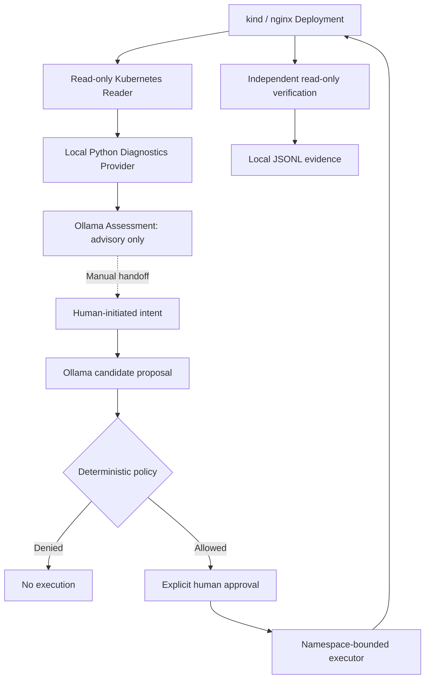
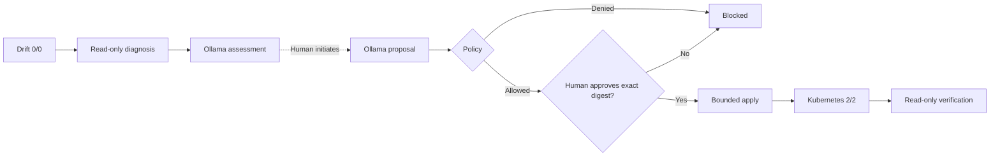
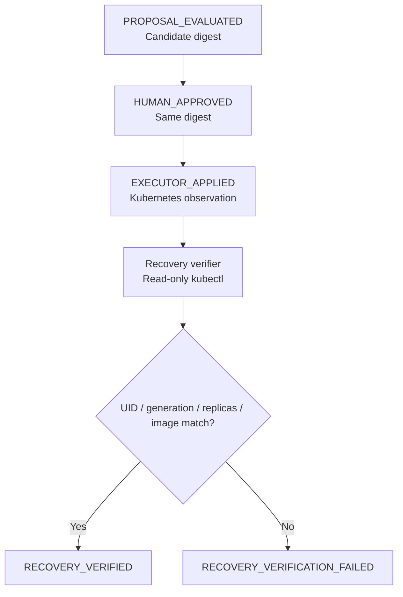

# AI Thinks. OpenKubes Executes. Evidence Proves.

*Build a human-governed AI recovery workflow for Kubernetes using OpenKubes, Ollama, and kind.*

**Hands-on tutorial · W-JAX 2026 · 15–20 minutes with an already prepared local lab**

> **Reproducibility note:** This walkthrough has been validated against an **already provisioned** local `kind-wjax-demo` cluster and local reader/executor credentials. The current repository does **not** yet provide a verified, one-command fresh-machine bootstrap. If you have cloned the repository from scratch, complete and validate the prerequisites first; do not assume `make wjax-demo` provisions the cluster or read-only reader. The implementation baseline is the [`wjax-2026-demo-v1.0` tag](https://github.com/openkubes/ok-console/tree/wjax-2026-demo-v1.0).

## What you will learn

A Kubernetes deployment can drift from its intended configuration even while its controller reports that the deployment has successfully rolled out. In this lab, we deliberately set an nginx Deployment to zero replicas, ask a read-only diagnostics provider to inspect it, use Ollama for advisory assessment and for a *separately initiated* operation proposal, and permit the repair only after deterministic policy evaluation and an explicit human click. Finally, we independently verify the resulting Kubernetes state.

The central principle is simple: **AI output is a proposal, not an authorization or proof of success.**

### The architecture used in this tutorial

**Figure 1 — Implemented local demo architecture**



**Implementation facts:** This uses a local Python diagnostics provider, **not kagent**. The assessment-to-proposal handoff is manual. Approval in the demo browser is not enterprise IAM. The local JSONL log is not cryptographically signed or tamper-proof. The executor's namespace-scoped `create deployments` permission is broader than a single resource name; the trusted demo application enforces its own exact allowlist. Never reuse this setup in production.

## 1. Prepare a safe local lab

Use the `openkubes/ok-console` repository and check out the verified version for reproducibility. You need Docker, kind, kubectl, Python 3, pnpm/Node.js, and Ollama with `llama3.2:latest`. You also need an already created local `wjax-demo` namespace and nginx Deployment, dedicated bounded executor Kubeconfig under `.wjax-local-runtime/`, and a separate read-only reader in the sibling `wjax-console-kind` directory. Those dependencies are **not fully bootstrapped by the present tutorial**.

```bash
# Execute from your existing prepared ok-console working copy.
cd /path/to/ok-console
# Optionally inspect the frozen baseline without switching a running demo:
git show --no-patch --oneline wjax-2026-demo-v1.0

kind get clusters
kubectl --context kind-wjax-demo -n wjax-demo get deploy wjax-nginx
ollama list
make wjax-demo-check
```

**Stop here** if `kind-wjax-demo` is absent, the current context points to an unexpected cluster, the dedicated executor credentials are missing, or bounded-RBAC checks fail. Do not substitute your administrator Kubeconfig for the executor Kubeconfig. All demo HTTP endpoints bind to `127.0.0.1`.

If you already have a running stack, inspect its status rather than launching another copy:

```bash
make wjax-demo-status
```

Otherwise:

```bash
make wjax-demo
make wjax-demo-status
make wjax-demo-diagnose
```

Expected: four local services respond (`console` :8790, `demo` :8788, `reader` :8791, and `diagnostics` :8793) and the diagnostics health/foreign-workload rejection test passes.

Open the three views in your browser:

- OpenKubes Console: `http://127.0.0.1:8790/#/clusters`
- Live kind view: `http://127.0.0.1:8790/wjax-kind.html`
- Agentic Operations demo: `http://127.0.0.1:8788/`

## 2. Create a controlled intent drift

First confirm a healthy nginx Deployment:

```bash
kubectl --context kind-wjax-demo -n wjax-demo get deployment wjax-nginx
```

Expected: `READY 2/2`.

**Only on the disposable local `kind-wjax-demo` cluster**, simulate drift by reducing the desired replica count:

```bash
kubectl --context kind-wjax-demo \
  -n wjax-demo scale deployment/wjax-nginx --replicas=0
kubectl --context kind-wjax-demo \
  -n wjax-demo get deployment wjax-nginx
```

Expected: `READY 0/0`. `kubectl rollout status` may still report success: the Deployment controller has reconciled the **new Kubernetes spec**, even though that spec violates our external expectation of two replicas. This is precisely the distinction between *Kubernetes reconciliation* and *application intent*.

## 3. Investigate without write permissions

Call the demo's diagnostics endpoint:

```bash
curl -fsS -X POST http://127.0.0.1:8788/api/diagnose \
  -H 'Content-Type: application/json' -d '{}' | python3 -m json.tool
```

Look for these key fields:

```json
{
  "decision": "MANUAL_REVIEW_REQUIRED",
  "execution_allowed": false
}
```

Inside `report.symptoms`, expect **`INTENT_DRIFT: configured replicas 0, expected 2`**. The local reader does not have permission to list Kubernetes Events; the report truthfully records that evidence as `unavailable`, rather than making up a cause.

Next request an advisory AI assessment:

```bash
curl -fsS -X POST http://127.0.0.1:8788/api/assess \
  -H 'Content-Type: application/json' -d '{}' | python3 -m json.tool
```

Expected: `assessment_source: "ollama"`, `decision: "MANUAL_REVIEW_REQUIRED"`, and `execution_allowed: false`. The model can suggest human checks; it cannot approve or execute the repair.

## 4. Generate a policy-checked operation proposal

**Figure 2 — Policy and approval gates**



In `http://127.0.0.1:8788/`, enter the **exact** allowlisted intent:

```text
Deploy nginx with two replicas to the demo cluster
```

Click **Generate candidate**. Verify that the candidate is precisely:

```json
{
  "operation": "deploy",
  "workload": "nginx",
  "replicas": 2,
  "target": "demo"
}
```

Expected digest for this exact candidate:

```text
149df04162d8a473cb715e36a695e4bb42896f425b29deb2121816918debedab
```

Also verify the UI reports policy `allowed: true` and source `OLLAMA:llama3.2:latest`. **Policy eligibility does not equal human authorization.** If the candidate is unexpected, deny or stop; never adjust the policy merely to make the demo pass.

## 5. Approve and execute one bounded repair

Click **Approve exact proposal** and then, in a separate deliberate action, **Execute authorized operation**. The local approval gate authorizes the exact candidate digest for a single execution attempt.

The trusted Python server builds a fixed nginx Deployment manifest and invokes `kubectl` using the dedicated executor Kubeconfig. The AI model never receives those credentials. An immediate response such as `APPLY_SUBMITTED_NOT_READY` means only that the Kubernetes API accepted the change—not that the pods are ready.

Confirm readiness independently:

```bash
kubectl --context kind-wjax-demo -n wjax-demo \
  rollout status deployment/wjax-nginx --timeout=90s
kubectl --context kind-wjax-demo -n wjax-demo \
  get deployment wjax-nginx
```

Expected: `READY 2/2`.

## 6. Verify recovery, not just an API success

**Figure 3 — Evidence checkpoints**



```bash
make wjax-demo-verify
```

On a newly approved execution, expect an evidence record like this (actual timestamp and generation vary):

```json
{
  "event": "RECOVERY_VERIFIED",
  "result": "READY_VERIFIED",
  "desired": 2,
  "ready": 2,
  "available": 2,
  "image_match": true
}
```

The verification correlates the latest `EXECUTOR_APPLIED` event with a prior matching human approval, then checks the Deployment UID, reconciled generation, two desired/ready/available replicas, and `nginx:1.27.5-alpine` image. When verification has already succeeded for the latest apply, `ALREADY_VERIFIED` is expected and no duplicate record is written.

**Observed in our October 26, 2026 rehearsal:** generation `5/5`, desired/ready/available `2/2/2`, image match `true`, result `READY_VERIFIED`. This is evidence about a *specific local run*, not a claim of production-grade attestation.

To inspect event types without displaying credentials:

```bash
python3 - <<'PY'
import json
from pathlib import Path
path = Path('.wjax-local-runtime/evidence.jsonl')
for line in path.read_text().splitlines()[-20:]:
    item = json.loads(line)
    print(item.get('event'), item.get('result', ''), item.get('digest', '')[:12])
PY
```

## 7. Test that policy also says “no”

In the Agentic Operations UI, click **Try forbidden production request**. The proposal must be denied (typically `TARGET_NOT_ALLOWED`); no approval or execution should be offered. Do not try to execute a previously approved candidate after switching requests.

This negative test is as important as a successful recovery: an agent's ability to propose actions must be bounded by deterministic controls.

## 8. Limitations, recovery, and next steps

This is a **local educational lab**, not the full OpenKubes production authorization system. It does not implement the OK-147 lifecycle executor, enterprise authentication, signed grants, or cryptographically verifiable evidence. Its local diagnostics provider follows ADR-021-inspired response patterns but is **not kagent**. A future integration may add kagent for Kubernetes-native agent execution and MCP-based investigation; it has not been demonstrated here.

If the local AI is down, the Ollama-dependent proposal should fail closed; do not describe deterministic parsing as AI. If readiness fails, report the observed state rather than forging a success record. The exact restoration procedure for a stuck rehearsal is in the [internal live-demo runbook](RUNBOOK.md); it uses an explicit administrative local-kind context and must never be presented as an authorized OpenKubes execution.

This tutorial intentionally requires an **already prepared** demo lab. Before publishing it as a completely reproducible fresh-clone exercise, we still need to validate cluster provisioning, read-only reader setup, bounded executor creation and credential refresh from an empty machine.

### Further reading

- [Versioned demo source and runbook](https://github.com/openkubes/ok-console/tree/wjax-2026-demo-v1.0/demos/wjax-2026)
- [OpenKubes Agentic Operations reference architecture](https://openkubes.org/agentic-operations-reference-architecture/)

**AI thinks. OpenKubes executes. Evidence proves.**
